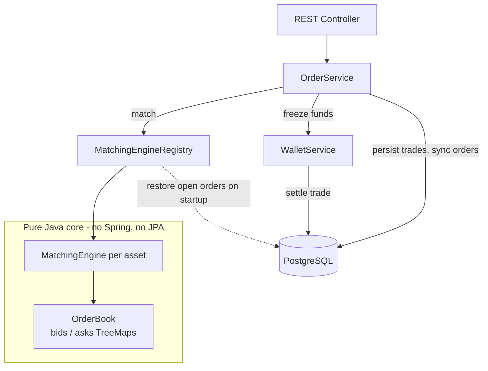

<div align="center">

# 📈 RTS: RealTradingSimulator

**A trading simulator built around a hand-written matching engine.**
Limit and market orders, price-time priority, partial fills and transactional settlement, all on a virtual currency.


</div>

> [!IMPORTANT]
> **RTS is a portfolio and learning project.** All assets, balances, trades and the in-app currency *Points* are fictional.
> Points have no monetary value, cannot be bought and are never exchanged for real money. This is not a financial product.

---

## ✨ Why this project

Most portfolio projects are CRUD apps. RTS is built around the problems that real exchanges have to solve:

- **Correct matching** of buyers and sellers (algorithms and data structures)
- **Concurrency**: many orders arriving at once must never match against the same liquidity twice
- **Transactional integrity**: money and assets must never be created or lost between order placement, trade and settlement
- **Crash recovery**: the order book lives in memory, so it has to be rebuilt from the database after a restart

---

## 🧩 Features

### Matching engine (pure Java, no framework)
- Order book built on two `TreeMap`s: bids sorted descending, asks ascending, so the best price is always `firstEntry()`
- **Price-time priority**: best price first, FIFO within a price level
- **LIMIT** and **MARKET** orders on both sides (BUY / SELL)
- **Partial fills** and multi-level sweeps (one order can consume several price levels)
- Trades execute at the **maker's price**, as on real exchanges
- MARKET orders follow **IOC** (Immediate-Or-Cancel): an unfilled remainder is cancelled, never rests in the book
- **Budget-limited MARKET buys**: an optional spending limit stops matching when funds run out, with fractional fills rounded down
- **Order cancellation**: a resting order can be removed from its price level
- Thread-safe through a `ReentrantLock` around matching and cancellation
- Fully **isolated from Spring and JPA**, so it is unit-tested without any application context

### Trading backend (Spring Boot + PostgreSQL)
- **Freeze / unlock balance model**: each wallet has `available` and `locked` amounts. Funds are reserved when an order is placed and released on cancel or settlement
- **Transactional settlement**: trade execution moves Points and assets between wallets atomically (`@Transactional`)
- **Price-improvement refund**: if a buyer's limit order fills at a better price than the limit, the difference is returned to `available`
- **Balance checks**: LIMIT orders need enough funds to freeze, MARKET BUY is capped by the buyer's `available` Points, MARKET SELL is rejected if the asset balance is too low. All of these return `400` before anything is persisted
- **Order cancellation**: releases frozen funds, marks the order `CANCELLED` and removes it from the in-memory book only after the transaction commits
- **Multi-asset design**: one independent engine and order book per approved asset
- **Crash recovery**: open orders are restored from the database into the engines on startup
- **Rollback recovery**: if a `placeOrder` transaction rolls back after matching, the asset's order book is rebuilt from the database, so the in-memory book never drifts from persisted state
- **Lazy wallet creation**: a wallet is created at the moment a trade needs it
- Domain model and persistence model are **separate classes** (`Order` vs `OrderEntity`), so the engine never depends on JPA

---

## 🏗️ Architecture



**Order lifecycle (`placeOrder`):**

1. Validate input and build the order
2. Check balances: freeze funds for LIMIT orders, verify the asset balance for MARKET SELL. Then persist the order
3. Look up the engine for the asset and run `match()`. A MARKET BUY passes the buyer's available Points as a budget
4. For each resulting trade: update both orders, persist the trade, settle both wallets
5. Cancel the unfilled remainder of a MARKET order (IOC)
6. Refund any price-improvement difference to the buyer
7. Return the up-to-date order state

If anything fails after step 3, the transaction rolls back and the asset's order book is rebuilt from the database.

### Order book structure

```
          ASKS (sell side, ascending)             BIDS (buy side, descending)
        ┌───────────────────────────┐          ┌───────────────────────────┐
        │ 60000 → [0.5] [0.3]       │ ← best   │ 59500 → [1.0] [0.5]       │ ← best
        │ 60100 → [1.0]             │          │ 59400 → [0.8]             │
        │ 60200 → [2.0] [0.7]       │          │ 59000 → [3.0]             │
        └───────────────────────────┘          └───────────────────────────┘
   TreeMap<Price, PriceLevel>                  PriceLevel = FIFO queue of orders
```

### Example: price-time priority in action

| Step | Action | Result |
|------|--------|--------|
| 1 | User A places **BUY 5 @ 1000** | No sellers, so the order rests in the book. 5000 Points are frozen |
| 2 | User B places **SELL 3 @ 900** | Prices cross, so a trade executes: **3 @ 1000** (maker's price) |
| 3 | Result | B receives 3000 Points. A receives 3 BTC. A's order is `PARTIALLY_FILLED` with 2 remaining, and 2000 Points stay frozen |

---

## 🛠️ Tech stack

| Layer | Technology |
|-------|-----------|
| Language | Java 21 |
| Framework | Spring Boot 4.1 (Web MVC, Data JPA, Validation, WebSocket) |
| Database | PostgreSQL |
| Build | Maven |
| Testing | JUnit 5 |
| Tooling | Lombok |

---

## 📁 Project structure

```
src/main/java/net/graysenko/RTS
├── MatchingEngine/               # Pure Java core. No Spring, no JPA
│   ├── Engine/                   #   MatchingEngine, OrderBook
│   ├── POJO/                     #   Order, PriceLevel
│   ├── Records/                  #   Trade (immutable record)
│   └── Enums/                    #   Side, OrderType, Status
└── Persistent/                   # Spring + JPA layer around the core
    ├── Entities/                 #   User, Wallet, Asset, OrderEntity, TradeEntity
    ├── Repositories/             #   Spring Data JPA repositories
    ├── Services/                 #   OrderService, WalletService, TradeService, ...
    ├── Controllers/              #   REST controller (temporary test endpoint)
    ├── DTO/                      #   Request / response records
    └── Utils/                    #   MatchingEngineRegistry (engines, startup and rollback recovery)
```

---

## 🚀 Getting started

### Prerequisites
- JDK 21
- PostgreSQL running locally
- Maven (or the included `./mvnw`)

### 1. Create a database
```sql
CREATE DATABASE rts_dev;
```

### 2. Configure credentials
Credentials are read from a `.env` file in the project root, which is git-ignored. Copy the template and fill it in:

```bash
cp .env.example .env
```

```properties
DB_USER=postgres
DB_PASSWORD=your_password
```

`application.properties` imports it and never contains secrets:

```properties
spring.config.import=optional:file:.env[.properties]
spring.datasource.url=jdbc:postgresql://localhost:5432/rts_dev
spring.datasource.username=${DB_USER}
spring.datasource.password=${DB_PASSWORD}
spring.jpa.hibernate.ddl-auto=update
```

### 3. Run
```bash
./mvnw spring-boot:run
```

On startup the app creates the schema, seeds the base assets **POINTS** and **BTC**, creates an engine per approved asset and restores any open orders from the database.

### 4. Create a demo user and wallet
Authentication is not implemented yet, so create a user and a funded wallet manually:

```sql
INSERT INTO users (email, password_hash, created_at)
VALUES ('demo@example.com', 'placeholder', now());

INSERT INTO wallets (user_id, asset_id, available, locked)
VALUES (
  (SELECT id FROM users  WHERE email  = 'demo@example.com'),
  (SELECT id FROM assets WHERE symbol = 'POINTS'),
  10000, 0
);
```

### 5. Place an order
```bash
curl -X POST http://localhost:8080/ \
  -H "Content-Type: application/json" \
  -d '{
        "userId": 1,
        "assetSymbol": "BTC",
        "side": "BUY",
        "orderType": "LIMIT",
        "price": 1000,
        "quantity": 5
      }'
```

Response:
```json
{
  "orderId": 1,
  "status": "OPEN",
  "remainingQuantity": 5,
  "quantity": 5,
  "price": 1000
}
```

### 6. Cancel an order
```bash
curl -X DELETE http://localhost:8080/1
```

Response: `Status:CANCELLED`. Cancelling an order that is already `FILLED` or `CANCELLED` returns its current status and changes nothing.

| Code | Meaning |
|------|---------|
| `400` | Invalid input or insufficient funds (the message explains which) |
| `404` | Unknown user, asset or order id |

> `POST /` and `DELETE /{orderId}` are a temporary test harness and will be replaced by a proper REST API.

---

## 🧪 Tests

```bash
./mvnw test
```

The matching engine is covered by unit tests that run without Spring. They cover:

- an order resting in the book when there is no counterparty
- an exact match of equal quantities
- a BUY sweeping multiple price levels with a partial remainder
- the SELL-side mirror cases
- a MARKET order with a partial fill and cancellation of the remainder (IOC)
- a MARKET BUY that stops when its budget runs out, including a fractional fill

---

## 🧠 Design decisions

| Decision | Why |
|----------|-----|
| Engine is pure Java, separate from JPA entities | Keeps the core fast to test and independent from infrastructure |
| `BigDecimal` for all prices and quantities | Avoids floating-point rounding errors in financial math |
| `available` / `locked` wallet split | Prevents spending the same funds on several open orders |
| Trade price = maker's price | Standard exchange behaviour, so the taker can get a better price than their limit |
| One engine per asset | Different markets are independent and must never match against each other |
| Settlement in a single `@Transactional` flow | Either every balance change is applied, or none |
| Orders restored from DB on startup | The order book is in-memory, so it must survive a restart |
| Book rebuilt from DB after a rollback | A DB rollback cannot undo in-memory changes made by `match()`, so the book is reloaded from the source of truth |
| Cancelled order removed from the book after commit | If the commit fails, the order stays both in the DB and in the book, so they never disagree |
| MARKET budget fills rounded down | Rounding up could buy slightly more than the buyer can pay |
| Engine receives a budget, not wallets | The core stays free of persistence while still respecting balances |
| Secrets in a git-ignored `.env` | Credentials never land in the repository |

---

## ⚠️ Known limitations

Honest notes on what is not solved yet:

- **Rebuild window after a rollback.** The order book lives in memory and is not part of the DB transaction. When `placeOrder` rolls back after `match()`, the affected asset's book is rebuilt from the database (`TransactionSynchronization.afterCompletion` → `rebuildEngine`), so memory and DB converge again. While the rebuild runs, another thread may still hold the old engine, and an order placed into it would be lost when the new engine is swapped in.
- **Concurrent MARKET buys by one user.** A MARKET BUY reads the buyer's `available` Points as its budget before matching and is charged after. Two MARKET buys from the same user running in parallel can both see the same balance and together drive it negative. Planned fix: lock the wallet row in the database (`SELECT ... FOR UPDATE`).
- **Cancellation window.** A cancelled order is removed from the in-memory book right after the commit. In that short window a concurrent order could still match against it.
- The engine uses a **global lock per asset**. A single-threaded command-queue design (LMAX-style) is a possible next step.
- No authentication yet, and input validation currently lives in the temporary controller.
- No integration tests for the persistence layer yet.

---

## 🗺️ Roadmap

- [x] Matching engine: LIMIT / MARKET, price-time priority, partial fills, IOC
- [x] Thread safety and unit tests
- [x] Persistence layer: users, wallets, assets, orders, trades
- [x] Freeze / unlock model and transactional trade settlement
- [x] Per-asset engines with startup recovery
- [x] Manual end-to-end test through a REST endpoint (LIMIT, MARKET, price-improvement refund)
- [x] Order book rebuild after a rolled-back transaction
- [x] Order cancellation with in-memory book removal (temporary endpoint)
- [x] Balance checks and budget-limited MARKET buys
- [ ] Wallet row locking against concurrent orders of one user
- [ ] Integration tests for the persistence layer
- [ ] Proper REST API
- [ ] Authentication (JWT + refresh tokens, Google OAuth2)
- [ ] WebSocket streams (live order book, trades, price)
- [ ] Market-maker bots seeded from real market prices
- [ ] React trading UI with candlestick charts
- [ ] Up/Down price predictions
- [ ] Points-earning mini-game with daily limit
- [ ] User profiles and leaderboard
- [ ] Docker + VPS deployment

---

## 👤 Author

**Graysenko**: Java / Spring Boot developer.
Built as an engineering-focused portfolio project to explore matching algorithms, concurrency and transactional design.
