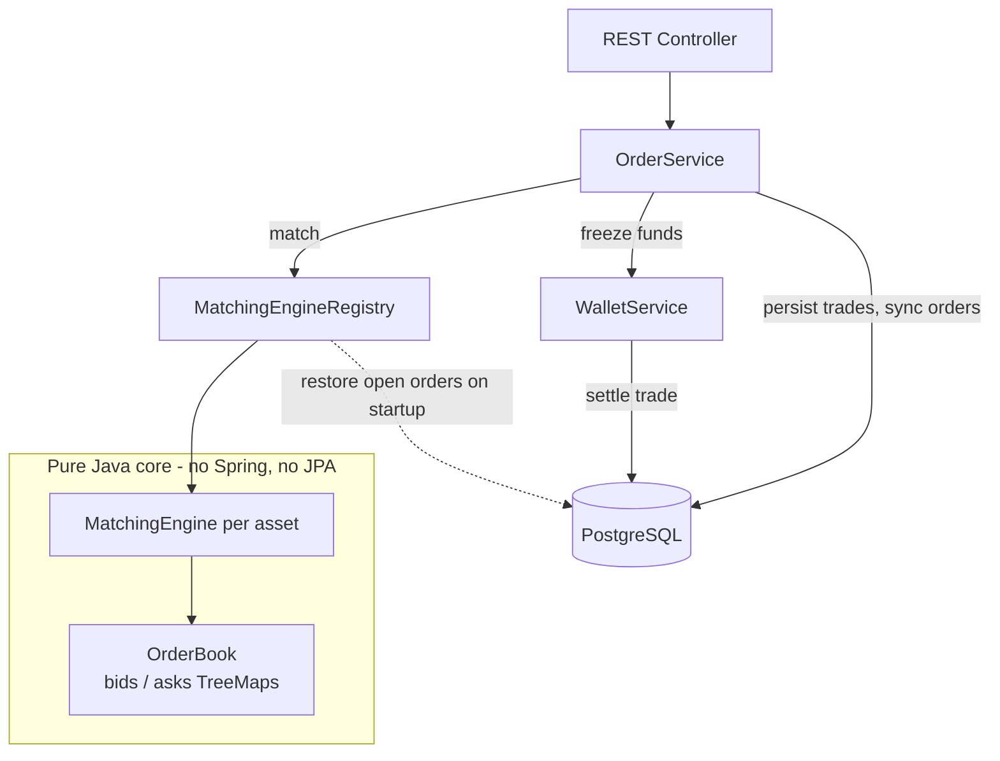

<div align="center">

# 📈 RTS: RealTradingSimulator

**A trading simulator built around a hand-written matching engine.**
Limit and market orders, price-time priority, partial fills and transactional settlement, all on a virtual currency.


</div>

> [!IMPORTANT]
> **RTS is a portfolio and learning project.** All assets, balances, trades and the in-app currency *Points* are fictional.
> Points have no monetary value, cannot be bought and are never exchanged for real money. This is not a financial product.

---

## ✨ Why this project

Most portfolio projects are CRUD apps. RTS is built around the problems that real exchanges have to solve:

- **Correct matching** of buyers and sellers (algorithms and data structures)
- **Concurrency**: many orders arriving at once must never match against the same liquidity twice
- **Transactional integrity**: money and assets must never be created or lost between order placement, trade and settlement
- **Crash recovery**: the order book lives in memory, so it has to be rebuilt from the database after a restart

---

## 🧩 Features

### Matching engine (pure Java, no framework)
- Order book built on two `TreeMap`s: bids sorted descending, asks ascending, so the best price is always `firstEntry()`
- **Price-time priority**: best price first, FIFO within a price level
- **LIMIT** and **MARKET** orders on both sides (BUY / SELL)
- **Partial fills** and multi-level sweeps (one order can consume several price levels)
- Trades execute at the **maker's price**, as on real exchanges
- MARKET orders follow **IOC** (Immediate-Or-Cancel): an unfilled remainder is cancelled, never rests in the book
- Thread-safe through a `ReentrantLock` around the matching routine
- Fully **isolated from Spring and JPA**, so it is unit-tested without any application context

### Trading backend (Spring Boot + PostgreSQL)
- **Freeze / unlock balance model**: each wallet has `available` and `locked` amounts. Funds are reserved when an order is placed and released on cancel or settlement
- **Transactional settlement**: trade execution moves Points and assets between wallets atomically (`@Transactional`)
- **Price-improvement refund**: if a buyer's limit order fills at a better price than the limit, the difference is returned to `available`
- **Multi-asset design**: one independent engine and order book per approved asset
- **Crash recovery**: open orders are restored from the database into the engines on startup
- **Lazy wallet creation**: a wallet is created at the moment a trade needs it
- Domain model and persistence model are **separate classes** (`Order` vs `OrderEntity`), so the engine never depends on JPA

---

## 🏗️ Architecture



**Order lifecycle (`placeOrder`):**

1. Validate input and build the order
2. Freeze funds (LIMIT orders), then persist the order
3. Look up the engine for the asset and run `match()`
4. For each resulting trade: update both orders, persist the trade, settle both wallets
5. Refund any price-improvement difference to the buyer
6. Return the up-to-date order state

### Order book structure

```
          ASKS (sell side, ascending)             BIDS (buy side, descending)
        ┌───────────────────────────┐          ┌───────────────────────────┐
        │ 60000 → [0.5] [0.3]       │ ← best   │ 59500 → [1.0] [0.5]       │ ← best
        │ 60100 → [1.0]             │          │ 59400 → [0.8]             │
        │ 60200 → [2.0] [0.7]       │          │ 59000 → [3.0]             │
        └───────────────────────────┘          └───────────────────────────┘
   TreeMap<Price, PriceLevel>                  PriceLevel = FIFO queue of orders
```

### Example: price-time priority in action

| Step | Action | Result |
|------|--------|--------|
| 1 | User A places **BUY 5 @ 1000** | No sellers, so the order rests in the book. 5000 Points are frozen |
| 2 | User B places **SELL 3 @ 900** | Prices cross, so a trade executes: **3 @ 1000** (maker's price) |
| 3 | Result | B receives 3000 Points. A receives 3 BTC. A's order is `PARTIALLY_FILLED` with 2 remaining, and 2000 Points stay frozen |

---

## 🛠️ Tech stack

| Layer | Technology |
|-------|-----------|
| Language | Java 21 |
| Framework | Spring Boot 4.1 (Web MVC, Data JPA, Validation, WebSocket) |
| Database | PostgreSQL |
| Build | Maven |
| Testing | JUnit 5 |
| Tooling | Lombok |

---

## 📁 Project structure

```
src/main/java/net/graysenko/RTS
├── MatchingEngine/               # Pure Java core. No Spring, no JPA
│   ├── Engine/                   #   MatchingEngine, OrderBook
│   ├── POJO/                     #   Order, PriceLevel
│   ├── Records/                  #   Trade (immutable record)
│   └── Enums/                    #   Side, OrderType, Status
└── Persistent/                   # Spring + JPA layer around the core
    ├── Entities/                 #   User, Wallet, Asset, OrderEntity, TradeEntity
    ├── Repositories/             #   Spring Data JPA repositories
    ├── Services/                 #   OrderService, WalletService, TradeService, ...
    ├── Controllers/              #   REST controller (temporary test endpoint)
    ├── DTO/                      #   Request / response records
    └── Utils/                    #   MatchingEngineRegistry (engines + startup recovery)
```

---

## 🚀 Getting started

### Prerequisites
- JDK 21
- PostgreSQL running locally
- Maven (or the included `./mvnw`)

### 1. Create a database
```sql
CREATE DATABASE rts_dev;
```

### 2. Configure `src/main/resources/application.properties`
```properties
spring.datasource.url=jdbc:postgresql://localhost:5432/rts_dev
spring.datasource.username=YOUR_USER
spring.datasource.password=YOUR_PASSWORD
spring.jpa.hibernate.ddl-auto=update
```

### 3. Run
```bash
./mvnw spring-boot:run
```

On startup the app creates the schema, seeds the base assets **POINTS** and **BTC**, creates an engine per approved asset and restores any open orders from the database.

### 4. Create a demo user and wallet
Authentication is not implemented yet, so create a user and a funded wallet manually:

```sql
INSERT INTO users (email, password_hash, created_at)
VALUES ('demo@example.com', 'placeholder', now());

INSERT INTO wallets (user_id, asset_id, available, locked)
VALUES (
  (SELECT id FROM users  WHERE email  = 'demo@example.com'),
  (SELECT id FROM assets WHERE symbol = 'POINTS'),
  10000, 0
);
```

### 5. Place an order
```bash
curl -X POST http://localhost:8080/ \
  -H "Content-Type: application/json" \
  -d '{
        "userId": 1,
        "assetSymbol": "BTC",
        "side": "BUY",
        "orderType": "LIMIT",
        "price": 1000,
        "quantity": 5
      }'
```

Response:
```json
{
  "orderId": 1,
  "status": "OPEN",
  "remainingQuantity": 5,
  "quantity": 5,
  "price": 1000
}
```

> The `POST /` endpoint is a temporary test harness and will be replaced by a proper REST API.

---

## 🧪 Tests

```bash
./mvnw test
```

The matching engine is covered by unit tests that run without Spring. They cover:

- an order resting in the book when there is no counterparty
- an exact match of equal quantities
- a BUY sweeping multiple price levels with a partial remainder
- the SELL-side mirror cases
- a MARKET order with a partial fill and cancellation of the remainder (IOC)

---

## 🧠 Design decisions

| Decision | Why |
|----------|-----|
| Engine is pure Java, separate from JPA entities | Keeps the core fast to test and independent from infrastructure |
| `BigDecimal` for all prices and quantities | Avoids floating-point rounding errors in financial math |
| `available` / `locked` wallet split | Prevents spending the same funds on several open orders |
| Trade price = maker's price | Standard exchange behaviour, so the taker can get a better price than their limit |
| One engine per asset | Different markets are independent and must never match against each other |
| Settlement in a single `@Transactional` flow | Either every balance change is applied, or none |
| Orders restored from DB on startup | The order book is in-memory, so it must survive a restart |

---

## ⚠️ Known limitations

Honest notes on what is not solved yet:

- **In-memory engine state is not rolled back with the DB transaction.** If a failure happens after `match()` but before the transaction commits, the database rolls back but the in-memory book keeps the changes. One cause (missing wallets) is already eliminated via lazy wallet creation, but the general problem remains and is a planned improvement.
- The engine uses a **global lock per asset**. A single-threaded command-queue design (LMAX-style) is a possible next step.
- No authentication yet, and input validation currently lives in the temporary controller.
- No integration tests for the persistence layer yet.

---

## 🗺️ Roadmap

- [x] Matching engine: LIMIT / MARKET, price-time priority, partial fills, IOC
- [x] Thread safety and unit tests
- [x] Persistence layer: users, wallets, assets, orders, trades
- [x] Freeze / unlock model and transactional trade settlement
- [x] Per-asset engines with startup recovery
- [x] Manual end-to-end test through a REST endpoint
- [ ] Integration tests for the persistence layer
- [ ] Order cancel endpoint and proper REST API
- [ ] Authentication (JWT + refresh tokens, Google OAuth2)
- [ ] WebSocket streams (live order book, trades, price)
- [ ] Market-maker bots seeded from real market prices
- [ ] React trading UI with candlestick charts
- [ ] Up/Down price predictions
- [ ] Points-earning mini-game with daily limit
- [ ] User profiles and leaderboard
- [ ] Docker + VPS deployment

---

## 👤 Author

**Graysenko**: Java / Spring Boot developer.
Built as an engineering-focused portfolio project to explore matching algorithms, concurrency and transactional design.
